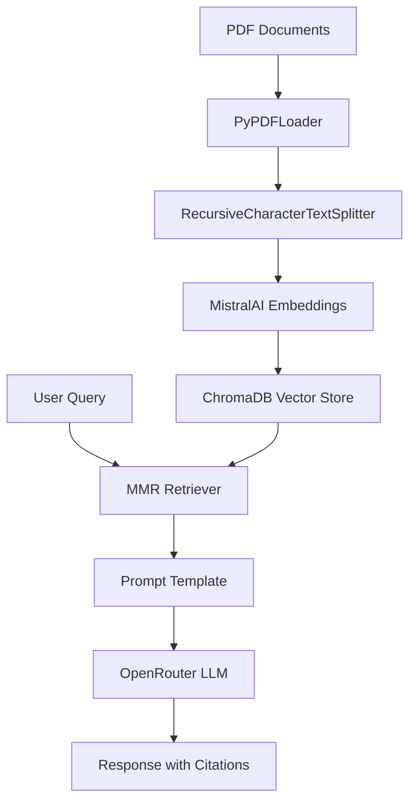

# Basic RAG System

A professional, high-performance Retrieval-Augmented Generation (RAG) system designed to transform static document knowledge into an interactive, AI-driven experience. This project bridges the gap between raw document data and intelligent, context-aware information retrieval.

---

## 🚀 Overview

The **Basic RAG System** allows users to build a searchable knowledge base from PDF documents. By combining **ChromaDB** for vector storage, **MistralAI** for high-quality embedding generation, and **OpenRouter** to leverage state-of-the-art LLMs, the system provides precise, source-cited answers to user queries.

### 🏗️ Architecture

The system operates through a clear pipeline:



---

## 🛠️ Key Components

The core intelligence of this system resides in its backend, which manages the lifecycle of knowledge ingestion and retrieval:

- **`create_database.py`**: Handles document ingestion. It loads PDF files, processes them into optimized chunks, generates semantic embeddings using MistralAI, and persists them into a ChromaDB vector database.
- **`main.py`**: The engine of the system. It implements the RAG pipeline by creating a retriever with diversity-focused search (MMR), constructing optimized prompts to ensure the LLM stays grounded in the context, and generating accurate responses.

---

## 📋 Setup & Usage

### Prerequisites
- Python 3.14+
- `pip`
- API keys for OpenRouter and MistralAI (configured in `.env`)

### Installation
1. Clone the repository:
   ```bash
   git clone https://github.com/yourusername/basic_rag_system.git
   cd basic_rag_system
   ```

2. Install dependencies:
   ```bash
   pip install -r requirements.txt
   ```

3. Configure your `.env` file:
   ```text
   OPENROUTER_API_KEY=your_key_here
   MISTRAL_API_KEY=your_key_here
   ```

### Running the System
- **Ingest Documents**:
  ```bash
  python create_database.py
  ```
- **Interact with the RAG System**:
  ```bash
  python main.py
  ```

---

## 🌐 Live Demo
The application features a modern, futuristic web interface for interacting with your documents.
[View Live Demo](https://prathambaraskar.github.io/basic_rag_system/)

*Note: The live demo runs in a client-side "Demo Mode". For full RAG backend capabilities, run the provided FastAPI server locally (`python server.py`).*

---

## 📄 License
This project is licensed under the MIT License - see the [LICENSE](LICENSE) file for details.
